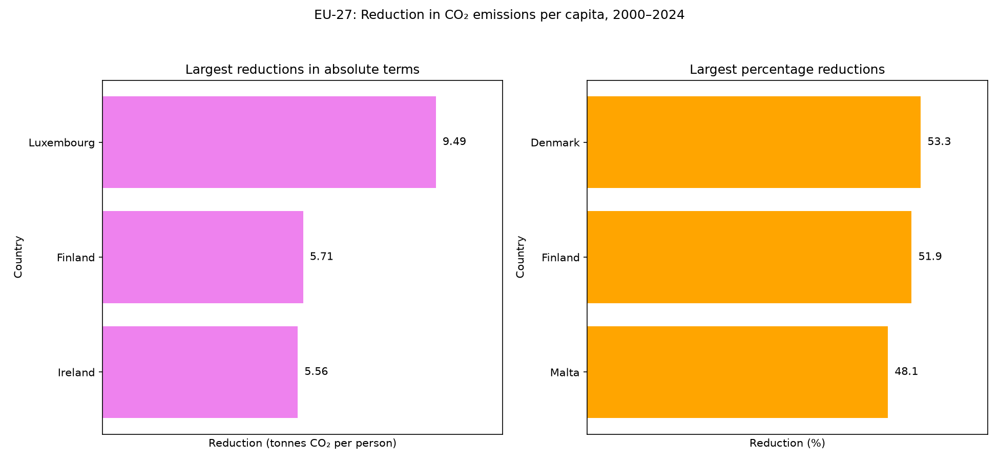

# co2-pipeline
A repo for Data Integration course (TH Köln), Lab 4, Tasks 2-7

## Research Question: Which EU country has reduced its CO₂ emissions per person the most since 2000?

There are two ways to interpret this question: in terms of the absolute reduction in emissions per capita (tonnes) or the relative reduction (percentage). We compared 27 EU countries using both measures:

1. If you read it as **tonnes per person** (t / person)
| # | Country | 2000 | 2024 | Cut |
| --- | --- | --- | --- | --- |
| 1 | Luxembourg | 19.953 | 10.460 | -9.493 |
| 2 | Finland | 11.015 | 5.301 | -5.714 |
| 3 | Ireland | 11.900 | 6.339 | -5.561 |

2. If you read it as **percent** (%)
| # | Country | 2000 | 2024 | Cut |
| --- | --- | --- | --- | --- |
| 1 | Denmark | 10.170 | 4.746 | -53.3 |
| 2 | Finland | 11.015 | 5.301 | -51.9 |
| 3 | Malta | 6.172 | 3.204 | -48.1 |

### Chart


### Which answer we would present
We would present the percentage-based comparison, with Denmark (-53.3%) as the answer. In tonnes, the "winner" Luxembourg starts from 19.95 t per person, which is partly caused by fuel sold to non-residents. Therefore, percentages compare countries with different starting levels more fairly. Furthermore, Finland ranks among the top three in both comparisons (-5.71 t, -51.9%), making it the most consistent runner-up.

## How to run the pipeline
```bash
# Clone the repo
git clone https://github.com/dreilingt/co2-pipeline.git

# Activate the environment and install packages
python -m venv .venv
source .venv/Scripts/activate
python -m pip install -r requirements.txt

# Run scripts one after another in the following order:
python src/download.py
python src/clean_co2.py
python -m pytest
python src/analyse.py
```

## Credits
- Dataset: Our World in Data, CO₂ and Greenhouse Gas Emissions, https://github.com/owid/co2-data, licence CC BY 4.0. Pinned version of 2 June 2026: commit `382ee6c662b0ece26e111f263b44c029afad7787`.
- Authors: Pablo Rosado, Hannah Ritchie, Max Roser, Edouard Mathieu, and Bobbie Macdonald.
- Original sources of the columns used (column `source` in the `codebook`):
  `co2`: Global Carbon Budget (2025), globalcarbonbudget.org
  `co2_per_capita`: Global Carbon Budget (2025) and Population based on various sources (2024)
  `country`, `year`: Our World in Data – Regions (2024)
  `population`: Population based on various sources (2024), ourworldindata.org/population-sources
  `iso_code`: International Organization for Standardization - Regions (2023)